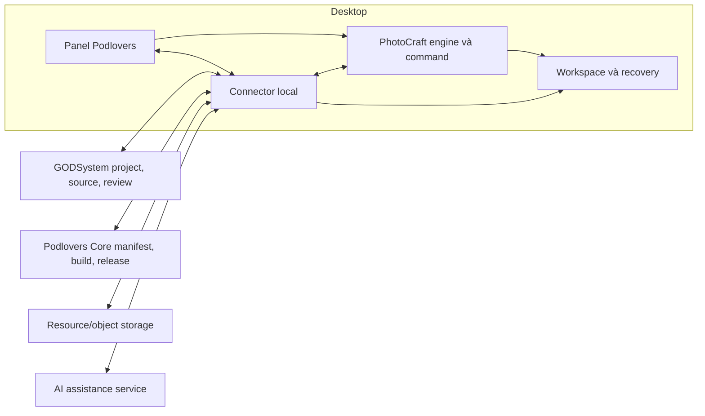
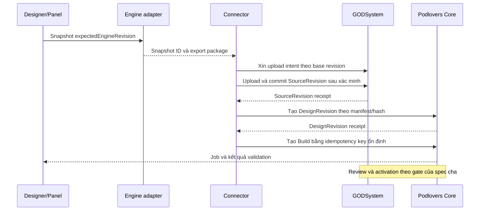

# Spec: Sepia desktop kết nối GODSystem và Podlovers

**Ngày:** 2026-11-04  
**Trạng thái:** Đã chốt bản đầu 2026-11-04 — sẵn sàng lập kế hoạch triển khai; câu hỏi mở §18 chốt trước phần liên quan  
**Module ID:** `photocraft-desktop`  
**Spec cha:** [Vòng đời artwork và campaign](../../../podlovers-mono/docs/superpowers/specs/2026-11-04-artwork-campaign-lifecycle-design.md)  
**Người dùng chính:** Designer; reviewer và người vận hành nhận kết quả nộp/kiểm chứng

## 1. Mục tiêu, quyết định và phạm vi

Xây Sepia, bản desktop fork từ PhotoCraft, có panel Podlovers và connector local được đóng gói cùng ứng dụng. Designer mở đúng sản phẩm/PSD từ GODSystem, thiết kế và khai báo personalization, thử đơn mẫu, xem lỗi trên canvas, rồi nộp snapshot để hệ thống build artwork/campaign.

### 1.1. Quyết định đã được người dùng xác nhận

- Ưu tiên desktop kết nối GODSystem.
- PSD mới bắt buộc tuân theo chuẩn khai báo vai trò layer và personalization.
- PSD cũ có đường nhập bằng rule/AI và kiểm chứng.
- GODSystem hiện có properties của từng đơn, chưa có schema customization đầy đủ.
- Tên sản phẩm của bản fork là **Sepia** (§12.1).

### 1.2. Hướng kiến trúc đề xuất để review

- Fork PhotoCraft với lớp thay đổi gọn: panel, command nghiệp vụ, metadata và export snapshot.
- Dùng connector local cho auth, download/upload, cache resource, offline journal và job status. Designer chỉ cần cài/chạy một bộ ứng dụng.
- PSD tiếp tục là nguồn trao đổi chính với GODSystem ở giai đoạn đầu; `.pcraft` dùng làm working/recovery document có định danh rõ ràng.
- Build/validation và quyết định release nằm ở backend theo spec cha. Desktop không tự tuyên bố ready hoặc đổi trạng thái duyệt bằng một lần Save.
- Giữ engine render production hiện tại trong phạm vi tích hợp đầu tiên. Thử nghiệm PhotoCraft headless làm renderer là nhánh riêng ở §15.

Spec này sở hữu UX desktop, metadata persistence, command boundary, connector và packaging. [Spec cha](../../../podlovers-mono/docs/superpowers/specs/2026-11-04-artwork-campaign-lifecycle-design.md#provider-contracts) sở hữu ProductRef, SourceRevision, DesignRevision, Build, ValidationReport, release và API provider. Không tạo bản định nghĩa độc lập của các DTO đó trong desktop.

## 2. Khả năng upstream và giới hạn đã kiểm tra

**Commit pin hiện tại của Sepia:** [`8e9277e20`](https://github.com/storytold/photocraft/commit/8e9277e20e8d5185ed4259908022a719a647237e) (đồng bộ 2026-11-05). So sánh `37a01ca87..8e9277e20`: các file làm bằng chứng cho mục này (`crates/doc/src/lib.rs`, `crates/format/src/manifest.rs`, `crates/io/src/psd_import.rs`, `crates/io/src/psd_export.rs`, `crates/psd/src/metadata.rs`, `crates/engine/src/inspect.rs`, `docs/plugins.md`) không đổi; `crates/automation/src/server.rs` dịch 2 dòng (`screenshot` nay ở L634) và `docs/control-protocol.md` đổi một dòng mô tả `layerFilter`. Không điểm nào trong số đó làm thay đổi kết luận của mục này, nhưng capability tests vẫn phải chạy lại trên commit pin trước pilot.

Đối chiếu mã/tài liệu upstream ngày 2026-11-04 tại commit [`37a01ca87`](https://github.com/storytold/photocraft/commit/37a01ca8746c121170644a07968d11263ef64407) (HEAD `main` của `storytold/photocraft` lúc viết spec; spec này nằm ngay trong repo upstream). Permalink bên dưới giữ nguyên ở commit audit này vì đó là mã đã thực sự đọc. Mọi link mã dưới đây là permalink theo commit đó, không trỏ `main` vì anchor dòng trôi khi upstream đổi. Bản triển khai chốt lại commit/release khi fork và chạy lại capability tests; không dùng một nhận xét từ README làm bằng chứng tương thích PSD Podlovers.

| Hiện có                                                                  | Ý nghĩa và giới hạn                                                                              |
| ------------------------------------------------------------------------ | ------------------------------------------------------------------------------------------------ |
| CLI, MCP, JSON-lines control; UI và headless có các transport khác nhau  | Có nền cho connector/AI; không giả mọi method hoạt động giống nhau ở desktop bridge và headless. |
| Layer có XMP, PSD `lyid`, document metadata; native format lưu layer XMP | Có thể dùng namespace riêng. Engine ID, PSD layer ID và UID nghiệp vụ phải được phân biệt.       |
| Layer XMP round-trip qua PSD ở block `shmd` › `cust` › `layerXMP`        | Import tách packet vào `Layer.xmp`, export ghi lại, phần còn lại của `shmd` giữ nguyên. Đã thấy trong mã, chưa kiểm bằng PSD Podlovers mở lại trong Photoshop. |
| Duplicate tạo ID mới, xoá PSD layer ID nhưng sao chép XMP                | Cần policy cấp UID nghiệp vụ mới trên mọi đường duplicate/copy.                                  |
| Plugin ABI v1 là WASM filter                                             | Không cung cấp panel nghiệp vụ; panel cần fork hoặc companion thử nghiệm.                        |
| MCP preview ở bridge chụp cửa sổ                                         | Phù hợp quan sát UI, không dùng làm ảnh chuẩn cho kiểm chứng hình học.                           |

Nguồn chính (commit `37a01ca87`): [control protocol](https://github.com/storytold/photocraft/blob/37a01ca8746c121170644a07968d11263ef64407/docs/control-protocol.md), [document model `Layer.xmp`](https://github.com/storytold/photocraft/blob/37a01ca8746c121170644a07968d11263ef64407/crates/doc/src/lib.rs#L680), [`Layer::duplicate`/`reassign_ids`](https://github.com/storytold/photocraft/blob/37a01ca8746c121170644a07968d11263ef64407/crates/doc/src/lib.rs#L756), [native manifest](https://github.com/storytold/photocraft/blob/37a01ca8746c121170644a07968d11263ef64407/crates/format/src/manifest.rs#L229), [PSD import layer XMP](https://github.com/storytold/photocraft/blob/37a01ca8746c121170644a07968d11263ef64407/crates/io/src/psd_import.rs#L479), [PSD export layer XMP](https://github.com/storytold/photocraft/blob/37a01ca8746c121170644a07968d11263ef64407/crates/io/src/psd_export.rs#L620), [`shmd` codec](https://github.com/storytold/photocraft/blob/37a01ca8746c121170644a07968d11263ef64407/crates/psd/src/metadata.rs#L110), [plugin API](https://github.com/storytold/photocraft/blob/37a01ca8746c121170644a07968d11263ef64407/docs/plugins.md), [MCP screenshot ở bridge](https://github.com/storytold/photocraft/blob/37a01ca8746c121170644a07968d11263ef64407/crates/automation/src/server.rs#L632).

`document.inspect` hiện cung cấp cây layer và `hasXmp`; không được suy ra từ đó rằng đã có API đọc/ghi manifest Podlovers hoặc đầy đủ geometry export. Cần command nghiệp vụ riêng. Xem [inspect implementation](https://github.com/storytold/photocraft/blob/37a01ca8746c121170644a07968d11263ef64407/crates/engine/src/inspect.rs#L111).

Vì hướng PSD-first (§16) dựa vào round trip layer XMP, capability test đầu tiên của pilot phải là: gắn `podl:*` vào layer trong Sepia, export PSD, mở và lưu lại bằng Photoshop, import lại, kiểm XMP còn nguyên (tiêu chí PC-21). Nếu Photoshop làm rơi hoặc viết lại packet thì hướng §5.2 phải xem lại trước khi làm panel.

## 3. Kiến trúc và ranh giới



| Thành phần     | Trách nhiệm                                                                                                         |
| -------------- | ------------------------------------------------------------------------------------------------------------------- |
| Panel          | Hiển thị ngữ cảnh product, slot, resource, preview, issue và nộp bản; không chứa một compiler khác backend.         |
| Engine adapter | Read/mutate tài liệu qua command, undo/redo, snapshot và export; không giữ service API key.                         |
| Connector      | Phiên đăng nhập, permission/capability negotiation, quản lý workspace, chuyển file, cache, journal và backend jobs. |
| GODSystem      | Công việc và quan hệ product/variant/PSD; source revision và source review theo spec cha.                           |
| Core           | Schema/binding đã xác nhận, DesignRevision, build/validation và activation.                                         |

Panel có thể gọi engine trực tiếp trong process; connector gọi qua adapter/control local có cùng typed contract. Engine không gọi HTTP nghiệp vụ trong command chỉnh sửa tài liệu. Tác vụ mạng dài chạy ngoài UI thread và trả job ID có thể quan sát.

Bản proof of concept được phép dùng companion UI để kiểm chứng provider/automation. Bản desktop mục tiêu phải tích hợp panel; không xem việc mở hai ứng dụng rời là đạt UX cuối cùng.

## 4. Trải nghiệm người dùng

### 4.1. Mở từ GODSystem

1. Designer chọn công việc hoặc product/variant và bấm **Mở thiết kế**.
2. Deep link đề xuất `podlovers://open?taskId=...` chuyển một định danh, không chứa bearer token, presigned URL hay đường dẫn local tuỳ ý.
3. Connector xác thực session, xin ProjectContext từ server và kiểm quyền. ID trong deep link không chứng minh quyền truy cập.
4. Hiển thị danh sách variant/source và yêu cầu nếu còn thiếu thông tin. Không tự chọn PSD có `updated_at` mới nhất cho mọi variant.
5. Tải gói nguồn vào workspace, xác minh file/hash và giải nén. Chọn entry PSD đúng theo project; archive ZIP không được truyền thẳng như một PSD cho editor.
6. Resolve font/resource theo danh tính/hash. Thiếu font hiện issue và trạng thái chưa đủ điều kiện nộp/phát hành theo gate liên quan.
7. Mở document, gắn project/document context và base revision. Nếu đã có working copy bẩn của cùng project thì đề nghị tiếp tục bản đó hoặc mở bản server riêng; không ghi đè local.

Nếu desktop chưa cài, GODSystem hướng tới installer. Cách đăng ký URL scheme và xử lý nhiều phiên desktop phụ thuộc OS pilot, cần chốt ở §18.

### 4.2. Bố cục panel

| Vùng               | Nội dung và hành động                                                                                     |
| ------------------ | --------------------------------------------------------------------------------------------------------- |
| Ngữ cảnh trên cùng | Product/ASIN, variant/print area, công việc, revision nguồn, trạng thái lưu và quyền hiện tại.            |
| Công việc          | Yêu cầu, ảnh tham chiếu, nhận xét review, danh sách source liên quan.                                     |
| Cá nhân hoá        | Chọn layer để gắn role, input, required/condition, repeat, crop/mask; xem mapping hai chiều field ↔ slot. |
| Tài nguyên         | Resource đúng phiên bản, font còn thiếu, clipart options và thành phần đã kiểm chứng.                     |
| Đơn mẫu            | Ca tổng hợp/đơn được phép xem, đầu vào và preview; phân biệt giá trị dữ liệu với field metadata.          |
| Kiểm chứng         | Build đang chạy, issue theo vùng/slot, bản source và bản renderer đích để so sánh.                        |
| Nộp bản            | Diff từ base revision, phạm vi product dùng chung PSD, kết quả gate và thao tác có quyền.                 |

UI dùng tên layer/input dễ hiểu; UID, hash, engine revision nằm trong chi tiết kỹ thuật dành cho hỗ trợ. Khi không chọn layer, panel hiển thị tổng quan; chọn nhiều layer cho phép gán cùng input khi role tương thích.

### 4.3. Authoring có ngữ nghĩa

- Gán text cố định hoặc text cá nhân hoá riêng; physical text layer chưa đủ để kết luận personalized.
- Gán ảnh khách vào một slot, xác định input, fit/crop, mask và print area; không nhầm clipart có sẵn với ảnh khách.
- Nhiều slot dùng cùng input biểu diễn text/ảnh lặp. Input khác biểu diễn dữ liệu độc lập.
- Variants và repeat group có miền giá trị/giới hạn/condition rõ ràng. Phải thấy các nhánh chưa có ca mẫu.
- Schema candidate từ order observations có nhãn nguồn suy luận. Designer/reviewer xác nhận qua quyền phù hợp; chưa thấy option không có nghĩa option không tồn tại.
- Đổi field/condition/input tạo thay đổi manifest và làm kết quả kiểm chứng cũ hết hiệu lực.

### 4.4. Preview và sửa lỗi

Preview dùng clone snapshot với input cụ thể. Không inject ảnh/tên thật vào working document rồi hy vọng undo khôi phục đúng sau crash. Đóng preview huỷ clone, không làm document nguồn dirty.

Preview tại editor là phản hồi nhanh. Preview renderer đích đến từ backend và gắn build/hash. Issue được chọn sẽ resolve `documentUid`/`sourceNodeUid`/`slotUid` sang node đang mở. Nếu node đã bị xoá hoặc document đã đổi, hiển thị issue của bản cũ và đề nghị build lại; không chọn layer cùng tên như fallback.

Lỗi hạ tầng hiển thị trạng thái có thể thử lại; lỗi thiếu binding/unsupported geometry hướng người dùng tới phần cần sửa. Không đưa stack trace/UUID vào thông điệp chính của designer.

## 5. Metadata và định danh

<a id="desktop-metadata"></a>

### 5.1. Các loại ID

| ID                       | Phạm vi và thời gian sống                                                             |
| ------------------------ | ------------------------------------------------------------------------------------- |
| `projectUid`             | Định danh project nghiệp vụ, do server xác nhận.                                      |
| `documentUid`            | Danh tính document trong project/source assembly, được giữ qua reopen/reorder/rename. |
| `sourceNodeUid`          | UID node nguồn; không phụ thuộc tên layer, index hoặc runtime engine ID.              |
| `slotUid`                | UID vị trí có role/binding; mới khi tạo một vị trí độc lập.                           |
| `inputKey`               | Input logic, được phép dùng chung nhiều slot/document trong DesignRevision.           |
| Engine document/layer ID | Định danh trong phiên Sepia; adapter resolve từ UID trước mỗi command.               |
| PSD layer ID             | Thông tin round-trip hỗ trợ đối chiếu, không thay thế UID nghiệp vụ.                  |
| `baseSourceRevisionId`   | Revision server mà working copy bắt đầu sửa; dùng phát hiện conflict.                 |
| `engineRevision`         | Bộ đếm thay đổi của document trong phiên; dùng chống thao tác lên trạng thái cũ.      |

Không dùng engineRevision làm source revision và không dùng ProductRef lấy từ XMP thay cho kiểm quyền/quan hệ ở server.

### 5.2. Namespace XMP và manifest

Đề xuất namespace `urn:podlovers:design:1`, prefix `podl`. Tên namespace này là quyết định mới cần giữ ổn định sau khi được duyệt.

Document XMP chứa schema version, project/document UID và source/base revision context. Layer XMP chứa node UID, slot UID khi có và role/binding authoring. Nội dung logic tương đương:

```json
{
  "schemaVersion": "1.0",
  "sourceNodeUid": "node-photo-front",
  "slotUid": "slot-photo-front",
  "role": "customer_image",
  "inputKey": "customer_photo",
  "printArea": "front",
  "fit": "cover",
  "maskNodeUid": "node-heart-mask"
}
```

JSON trên mô tả model, không phải nhúng nguyên JSON vào XMP không có serializer. Cần codec XMP versioned, giữ namespace của ứng dụng khác, kiểm schema khi đọc, không làm mất dữ liệu unknown khi save.

Trong working copy, metadata và geometry trong document là nguồn authoring. Khi export snapshot, adapter sinh manifest theo [contract của spec cha](../../../podlovers-mono/docs/superpowers/specs/2026-11-04-artwork-campaign-lifecycle-design.md#manifest-contract). Manifest bytes/hash được chốt cùng file; không có hai bản mutable XMP/sidecar được sửa độc lập rồi tự chọn bản mới nhất.

Source legacy chưa có UID được onboarding trên clone/candidate; việc gắn UID là thay đổi có lịch sử. Nếu import/export qua editor khác làm mất metadata, hiển thị `METADATA_LOST` và đi luồng đối chiếu/xác nhận. Fingerprint tên/bounds/crop chỉ hỗ trợ tìm lại, không âm thầm chuyển binding sang node gần giống.

### 5.3. Duplicate, copy và undo

| Thao tác                       | Quy tắc                                                                                                                               |
| ------------------------------ | ------------------------------------------------------------------------------------------------------------------------------------- |
| Rename/reorder/move node       | Giữ UID và input, cập nhật geometry theo document.                                                                                    |
| Duplicate node/group           | Cấp node/slot UID mới cho toàn bộ subtree; xác định rõ lặp cùng input hay tạo input mới. Trạng thái chưa chọn không đủ điều kiện nộp. |
| Duplicate độc lập smart object | Xác định cả quan hệ shared contents; hai slot input độc lập không được vô tình thay ảnh cùng nhau.                                    |
| Copy sang project khác         | Cấp UID phù hợp project mới, bỏ ngữ cảnh product/source cũ và yêu cầu xác nhận binding/resource.                                      |
| Delete                         | Xoá node, đánh dấu binding/mask/condition refs bị dangling; không tự nối lại theo tên.                                                |
| Undo/redo                      | Khôi phục cả geometry và metadata/UID trong cùng transaction.                                                                         |
| Fork project                   | Có lineage tới source cũ nhưng project mới không được nhận nhầm quyền hoặc active release cũ.                                         |

Kiểm tra trùng UID khi mở và trước snapshot. Tất cả đường copy/duplicate, kể cả shortcut/menu và AI, phải được bao phủ; chỉ cung cấp một command duplicate mới mà bỏ đường built-in là chưa đạt yêu cầu.

## 6. Command và IPC contract

### 6.1. Envelope đề xuất

Các command `podlovers.*` dưới đây chưa tồn tại trong upstream. Chúng dùng typed adapter riêng; không giả envelope chuẩn control channel hiện có đã hỗ trợ các trường này.

```json
{
  "operationId": "operation-01",
  "projectUid": "project-01",
  "documentUid": "doc-front",
  "expectedEngineRevision": 42,
  "command": "podlovers.slot.assign",
  "params": {
    "sourceNodeUid": "node-photo-front",
    "role": "customer_image",
    "inputKey": "customer_photo",
    "printArea": "front"
  }
}
```

Reply thành công có operation ID, trước/sau revision và changes summary. Reply lỗi có error code, message, retryable và revision hiện tại nếu được phép. Không mutate khi precondition không đạt.

### 6.2. Surface tối thiểu

| Command                      | Input chính                                                              | Output/bất biến                                                                   |
| ---------------------------- | ------------------------------------------------------------------------ | --------------------------------------------------------------------------------- |
| `podlovers.project.inspect`  | Project/document UID                                                     | Context, engine revision, nodes/slots, resource requirements, issues; read-only.  |
| `podlovers.slot.assign`      | Node UID và role/input/condition refs                                    | Metadata được validate và áp dụng một undo step.                                  |
| `podlovers.slot.duplicate`   | Node UID, chính sách input của bản sao                                   | UID mới và mapping subtree; cùng semantics với các đường duplicate khác.          |
| `podlovers.preview.create`   | Snapshot identity, typed fixture refs                                    | Preview session ID trên clone, không làm nguồn dirty.                             |
| `podlovers.preview.dispose`  | Preview session ID                                                       | Thu hồi clone/temp; có thể gọi lại an toàn.                                       |
| `podlovers.project.snapshot` | Expected assembly version và map document UID → expected engine revision | Snapshot ID bất biến, document set và hash inputs.                                |
| `podlovers.project.export`   | Snapshot ID, output capability                                           | Bundle/manifest/resource requirement refs, hashes, warnings/unsupported features. |
| `podlovers.operation.get`    | Operation ID                                                             | Receipt/state để giải quyết timeout; read-only.                                   |

Theo quy tắc "everything is a command" của upstream, mỗi command `podlovers.*` là một command engine có id, label, params doc, `enabled` và `run`. Đặt chúng trong module mới `crates/engine/src/cmd/podlovers_cmds.rs` có hàm `specs()`, rồi đăng ký bằng một dòng `v.extend(...)` trong `crates/engine/src/cmd.rs`. UI, CLI, control channel và MCP đều dispatch theo id đó, không có đường gọi riêng. `run` không được panic với bất kỳ params hay trạng thái document nào: params sai, UID không tồn tại hoặc revision cũ đều trả `Err`. Mỗi command có test lỗi và phải qua `cargo test -p photocraft-engine --test panic_hunt -- --ignored`.

Mutation phải kiểm tra project/document/revision ngay trước apply và commit metadata trong history transaction. AI output không được tự chọn arbitrary engine command hoặc ambient filesystem path ngoài surface cho phép.

Snapshot toàn project phải kiểm tra tập document và revision của từng document trong một bước capture nhất quán. Thêm/bớt document làm tăng assembly version. Không capture lần lượt các file live trong lúc designer tiếp tục sửa rồi gọi chúng là một snapshot. Export và upload đọc dữ liệu đã capture, không đọc lại working file có thể đã thay đổi.

`operationId` giữ nguyên khi retry cùng intent. Local operation journal lưu request hash và receipt cùng snapshot/history commit để tránh áp dụng hai lần sau timeout/crash. Cùng ID khác params bị từ chối. Nếu không chứng minh được thao tác cũ đã xảy ra hay chưa thì trạng thái `unknown`, kiểm tra/reconcile trước khi thử lại. Không tự gửi lại một edit chỉ vì bridge mất kết nối.

### 6.3. Capability negotiation và transport

Connector kiểm version protocol, upstream commit, command availability và feature flags lúc khởi động. Backend cung cấp manifest/capability versions và giới hạn ingest/build. Không hỗ trợ version thì chuyển read-only hoặc báo không tương thích, không đoán tên command/params.

Dùng IPC có xác thực hoặc loopback control đã có, chỉ cấp workspace read/write roots cần thiết. Không mở control channel ra mạng và không đưa token vào deep link/log. Các method desktop bridge và headless phải có capability tests riêng, đặc biệt open/save, thay smart object, export và render.

MCP phục vụ AI/tooling; các tác vụ connector có cấu trúc có thể dùng typed IPC/control trực tiếp, không bắt mọi upload/status poll đi qua LLM/MCP.

## 7. Workspace, resource và phục hồi

Workspace được quản lý theo project, không theo tên file người dùng tự đặt. Gồm source package, working document, recovery checkpoints, export snapshots, resource cache và operation/upload journal. Path từ archive được kiểm tra để không thoát workspace; tài nguyên link ngoài phải được resolve thành dependency được phép trước khi nộp.

File source package giữ hash và entry manifest; chuẩn xuất bản là ZIP đúng contract ingest. Gói legacy có định dạng khác cần adapter nhập được kiểm tra; không đổi đuôi archive để gửi vào parser ZIP.

Font/resource cache dùng resource revision/hash, không dựa vào file name. Kiểm tra đúng bytes, face và glyph coverage trước preview/submit. UI phân biệt resource chưa tải, sai quyền, không tồn tại và không được renderer hỗ trợ. Không tự thay font tương tự rồi ẩn issue.

Autosave checkpoint phải khôi phục được geometry, metadata và pending operations. Sync offline ghi intent bền vững, resume upload nếu storage hỗ trợ; trường hợp presigned URL hết hạn xin URL mới cho cùng intent. File partial chưa được server commit không xuất hiện như SourceRevision hoàn chỉnh.

Quota disk và cleanup không được xoá working copy bẩn, checkpoint mới nhất hoặc export đang upload/build. Artifact đã được server xác nhận có thể cleanup theo retention local. Cần đủ dung lượng cho PSD, giải nén, resource và snapshot; giới hạn thực tế được đo ở pilot, không coi file nhỏ là đủ bảo đảm RAM.

## 8. Save, sync draft, nộp bản và review

### 8.1. Trạng thái phải hiển thị riêng

| Trạng thái           | Ý nghĩa                                                                          |
| -------------------- | -------------------------------------------------------------------------------- |
| Đã lưu local         | Working document/checkpoint được ghi; chưa bảo đảm server có bản đó.             |
| Đã đồng bộ nháp      | Server giữ snapshot nháp, không đổi source approval hoặc release.                |
| Đã nộp               | SourceRevision/DesignRevision đã được cố định và có submission receipt.          |
| Source được duyệt    | Review attestation cho đúng revision/hash.                                       |
| Build đạt kiểm chứng | Validation pass cho đúng output/toolchain/policy; không tự đồng nghĩa đang dùng. |
| Release đang dùng    | Product active pointer trỏ tới release được backend xác nhận.                    |

### 8.2. Nộp bản từ snapshot



Sequence thể hiện logic; upload bytes có thể trực tiếp object storage bằng URL ký sẵn. Snapshot đã nộp không đổi khi designer tiếp tục sửa working copy. Mọi progress/result phải ghi rõ nó thuộc snapshot nào.

Một submission có thể chọn nhiều product dùng chung source. Connector tạo một DesignRevision và Build cho từng ProductRef theo spec cha, giữ receipt/idempotency intent riêng cho từng product trong cùng nhóm submission. Binding profile của product này không được dùng nhầm cho product khác; mỗi product kích hoạt release độc lập.

Connector không gọi `sourceFrom=listing-upload` cho autosave/sync. Cần provider API mới tách nháp/nộp/review, vì [luồng hiện tại](../../../god-system-backend-next/internal/modules/psd_file/biz/upload.go) có tác dụng phụ pass PSD và đổi task.

Nộp một revision mới phải được build dù listing từng được gửi trước đó; [GOD dispatcher hiện có](../../../god-system-backend-next/internal/modules/psd_file/biz/podlovers.go) và endpoint tạo campaign từ item không đủ làm đường rebuild. Dùng API revision/build của spec cha; giữ adapter cũ cho luồng legacy.

### 8.3. Conflict và dùng chung PSD

Source commit dùng base revision/ETag ở server. Hai working copy cùng base nộp đồng thời: một commit thắng, bản còn lại nhận conflict và được giữ để so sánh/mở thành branch. Không tự merge binary PSD hoặc upload ghi đè.

Trước khi nộp hiển thị source đang được những variant/product nào dùng. Candidate chọn phạm vi product tường minh. Source approval không tự kích hoạt release của toàn bộ product dùng chung.

Lỗi sau source commit nhưng trước DesignRevision/build phải resume từ receipts, không upload/nộp source lần nữa. Backend reconciliation theo spec cha xử lý submission đang dở; desktop không tự đánh dấu thành công khi mới upload xong bytes.

## 9. Kiểm chứng trong desktop

Local lint phản hồi nhanh cho UID trùng, binding dangling, required input chưa khai báo, resource thiếu và feature chưa hỗ trợ. Server validation là kết luận cuối cùng. Quy tắc hợp đồng dùng version/schema chung; desktop không duy trì một bộ business rule khác rồi tự cấp pass.

Nguồn ảnh kiểm chứng phải là export tài liệu hoặc headless render với kích thước, color/alpha profile xác định. Screenshot có chrome UI, zoom, selection hoặc display scaling chỉ dùng quan sát UI.

Khi PSD là nguồn trao đổi chính, export snapshot rồi mở lại đúng file vừa xuất: xác minh UID/XMP, source assembly, geometry/reference và capability warnings. Tính năng chỉ sống được trong working `.pcraft` nhưng không giữ được qua PSD phải hiện issue trước nộp; không âm thầm phát hành bản PSD mất nghĩa.

So ba thứ có provenance riêng khi cần: source đã được duyệt, document export sau round trip và artifact gen-png. Cùng một engine mở/lưu/render lại không đủ chứng minh nhập đúng PSD gốc. Ngưỡng và test coverage dùng ValidationPolicyRevision của spec cha, không do panel tự chọn.

## 10. Trợ lý AI trong editor

Context tối thiểu: product/task, document/engine revision, layer đang chọn, role/input hiện tại, crop cần thiết và schema observations được phép xem. Model không cần nhận toàn bộ PSD hoặc toàn bộ lịch sử khách hàng cho mọi yêu cầu.

Các intent đầu tiên: gắn slot theo layer đang chọn, liên kết text lặp, đề xuất role cho PSD cũ, tạo repeat/variant trong miền khai báo, giải thích issue và tìm resource đã tồn tại. Đề xuất được biểu diễn thành typed operations với evidence, diff và preview; apply thành undoable transaction.

Thay đổi geometry/role/input phải có sự chấp nhận của designer cho intent đó hoặc automation policy đã cấu hình; model không tự nộp/phát hành hoặc thay gate. Một lệnh rõ ràng của người dùng có thể cấp quyền cho cả chuỗi thao tác trong phạm vi đó, không cần hỏi lại mỗi command.

Kết quả model phải được validate theo schema, quyền và expected revision. Nội dung PSD, tên layer và properties đơn là dữ liệu không tin cậy; câu chữ trong đó không được mở rộng quyền điều khiển. Model/prompt version và kết quả sửa được ghi để audit/eval; lỗi model không làm mất thiết kế đang làm.

## 11. Auth, quyền và dữ liệu local

Tận dụng identity GODSystem/GODAuthy nhưng chưa giả định có OAuth/device flow desktop sẵn. Cần chốt protocol cấp session và refresh, mapping actor và device binding trước pilot kết nối thật. Installer không chứa SYSTEM API key hoặc credential service của psd-to-artwork.

Connector giữ credential bằng cơ chế bảo vệ phù hợp OS; panel/engine chỉ nhận context và quyền cần thiết. Backend kiểm quyền product/project/source/resource mỗi lần mở, nộp, review và activation, kể cả idempotent replay. Quyền lưu nháp không mặc nhiên cho quyền duyệt source hay phát hành.

Deep link không được yêu cầu tải/mở arbitrary URL hoặc thực thi shell. Local IPC giới hạn user/workspace; telemetry không chứa token, URL ký sẵn, properties nguyên văn hay ảnh khách. Fixture synthetic ưu tiên cho regression; dữ liệu đơn thật theo quyền/retention của spec cha. Đăng xuất thu hồi session local, giữ working copy theo chính sách được công bố thay vì xoá thiết kế chưa đồng bộ.

## 12. Mã nguồn, đóng gói và tương thích

Fork PhotoCraft là repository riêng; không chép toàn bộ source Rust vào monorepo hiện tại. Đường dẫn dưới đây là vùng thay đổi dự kiến trong fork, chưa được tạo bởi spec:

| Vị trí                                        | Thay đổi                                                                                                           |
| --------------------------------------------- | ------------------------------------------------------------------------------------------------------------------ |
| `crates/ui-egui/`                             | Panel, overlay slot/issue và hành động UX.                                                                         |
| `crates/engine/`                              | Typed `podlovers.*` command adapter, metadata history, snapshot và preconditions.                                  |
| `crates/doc/`, `crates/io/`, `crates/format/` | Tận dụng XMP hiện có; thay đổi tối thiểu để bảo đảm codec, duplicate/copy và round trip.                           |
| `crates/automation/`                          | Surface nghiệp vụ và capability contract cho connector/AI.                                                         |
| Connector package mới                         | Auth, workspace, resource cache, upload journal và provider client; ngôn ngữ/runtime cần chốt theo đội triển khai. |

UI tiếp tục là Rust/egui theo upstream, không thêm webview chỉ để nhúng dashboard. Có thể viết connector bằng Go theo stack backend hiện tại, nhưng đây là lựa chọn đề xuất, chưa có binary/lệnh build tồn tại.

Mỗi bản desktop ghi upstream commit, phiên bản fork/connector/protocol/metadata codec và schema versions hỗ trợ. Installer kèm connector và cách khởi động/thoát rõ ràng, không để tiến trình nền mồ côi. Chốt OS pilot, signing và cập nhật trước khi phân phối cho designer.

Update không tự migrate/xoá working copy chưa có backup. App đọc được metadata mới hơn nhưng không hiểu thì chuyển read-only và hướng dẫn cập nhật; không save làm rơi field chưa hiểu. Backend công bố minimum compatible client/protocol; giữ recovery/export path cho người đang offline.

### 12.1. Tên sản phẩm và branding

Bản fork mang tên **Sepia**. Trong spec, "Sepia" chỉ bản desktop nội bộ; "PhotoCraft" chỉ upstream và engine/crate kế thừa từ upstream.

| Phạm vi                         | Quy tắc                                                                                                                                                                                                                           |
| ------------------------------- | --------------------------------------------------------------------------------------------------------------------------------------------------------------------------------------------------------------------------------- |
| Tên hiển thị                    | Window title, About, splash, installer, shortcut menu Start/Dock, thông báo lỗi và tài liệu cho designer đều dùng "Sepia".                                                                                                       |
| ArtCraft marks                  | Gỡ hoặc thay mọi file trong `docs/brand/` và mọi chỗ dùng chúng trong app/installer, theo [`docs/brand/LICENSE-brand.txt`](../brand/LICENSE-brand.txt). Không gọi Sepia là sản phẩm ArtCraft hay ngụ ý ArtCraft Team bảo trợ. |
| Ghi nguồn                       | About ghi bằng chữ thường "Based on PhotoCraft by the ArtCraft team", kèm link upstream và commit đã pin.                                                                                                                       |
| License                         | Giữ file license MIT/Apache-2.0 và NOTICE (nếu có) trong source và installer. File upstream đã sửa mang ghi chú đã sửa theo Apache-2.0 §4.                                                                                       |
| Tên máy                         | Giữ nguyên tên crate `photocraft-*`, đường dẫn và module Rust kế thừa để giảm conflict khi merge upstream. Crate/package mới của fork (connector, panel riêng nếu tách) dùng tiền tố `sepia-`.                                  |
| Binary, app id, URL scheme      | Binary phân phối, bundle/app id và vị trí config/workspace đổi sang tên riêng của Sepia để không đụng bản PhotoCraft chính thức cài cùng máy. Giá trị cụ thể chốt ở PC-O8. Deep link vẫn dùng `podlovers://` theo §4.1.         |
| Quy tắc agent                   | `AGENTS.md` của fork ghi đè quy tắc đặt tên của upstream bằng quy tắc trong mục này; các quy tắc kỹ thuật ở §12.2 giữ nguyên.                                                                                                    |

Module ID `photocraft-desktop` và tên file spec giữ nguyên vì spec cha và tài liệu Podlovers khác tham chiếu tới chúng.

### 12.2. Ràng buộc từ quy tắc upstream

Fork vẫn theo [`AGENTS.md`](../../AGENTS.md) để giữ khả năng nhận cập nhật upstream. Các điểm chạm tới thiết kế này:

| Quy tắc                  | Áp dụng cho Podlovers                                                                                                                                                                                                                               |
| ------------------------ | --------------------------------------------------------------------------------------------------------------------------------------------------------------------------------------------------------------------------------------------------- |
| Layering (`cargo xtask layers`) | XMP codec `podl`, quy tắc UID và duplicate policy nằm ở `doc` (L1), `format`/`io` (L3/L4). Command ở `engine` (L5). Panel ở `ui-egui` (L6). Không crate L0–L5 nào phụ thuộc HTTP client, connector hay IPC của connector. Crate mới phải đăng ký trong `xtask/src/layers.rs`. |
| Wasm (`cargo xtask wasm`) | L0–L6 phải `cargo check --target wasm32-unknown-unknown`. Client IPC/loopback tới connector trong panel đặt sau `cfg(not(target_arch = "wasm32"))` hoặc đi qua platform services. Bản web không có connector thì panel chuyển read-only hoặc ẩn. |
| Native format            | Thêm field vào `photocraft-doc` (ví dụ context project trong document metadata) phải map trong `crates/format/src/manifest.rs` và `convert.rs` với `#[serde(default)]`, và map sang PSD trong `crates/io` nếu có tương đương. Ưu tiên giữ mọi thứ trong XMP hiện có để không cần field mới. |
| Never crash              | Code mới không dùng `unwrap`/`expect`/`panic!`, không `unsafe`. XMP `podl` đọc từ file là dữ liệu không tin cậy: giới hạn kích thước, độ sâu, số slot. Mỗi crash fix có regression test. |
| UI thin, data-driven     | State panel nằm trong `ui-egui/src/state.rs` (serde) để control channel đọc/điều khiển được. Màu/radius lấy từ `theme::Tokens`. Thay đổi UI kiểm bằng `cargo run -p photocraft-ui-egui --example snapshot`. |
| Không webview            | Connector là process riêng, không kèm Tauri/Electron/webview. Panel là egui thuần.                                                                                                                                                                  |

Gate trước khi merge mỗi thay đổi trong fork: `cargo test -p <crate>`, `cargo clippy -p <crate> --all-targets -- -D warnings`, `cargo xtask layers`, `cargo xtask wasm`, `panic_hunt` nếu đổi command và `cargo xtask test-corpus` nếu đổi `psd`/`io`/`format`.

### 12.3. Ví dụ code style cho adapter mới

```rust
pub struct AssignSlot {
    pub operation_id: String,
    pub document_uid: String,
    pub expected_engine_revision: u64,
    pub source_node_uid: String,
    pub input_key: String,
}
```

Đây là minh hoạ naming, không phải type đã có. Rust snake_case, DTO JSON camelCase qua serialization rõ ràng; dùng typed IDs và structured errors khi triển khai. Các side effect đi qua command/history; không sửa trực tiếp document từ một HTTP callback của panel.

### 12.4. Lệnh upstream đã được tài liệu hoá

Chạy từ root fork sau khi checkout và chuẩn bị Rust/native dependencies theo [development guide](https://github.com/storytold/photocraft/blob/37a01ca8746c121170644a07968d11263ef64407/docs/development.md):

```sh
cargo build --release -p photocraft -p photocraft-cli
cargo test --workspace
cargo run --release -p photocraft -- ./fixtures/product.psd
```

Ví dụ chạy binary với workspace thử nghiệm đã tạo trước; token file không nằm trong repo:

```sh
photocraft --control 7878 \
  --control-token-file /tmp/podlovers-control.token \
  --automation-read-root /tmp/podlovers-workspace \
  --automation-write-root /tmp/podlovers-workspace

photocraft-cli mcp --bridge 127.0.0.1:7878 \
  --control-token-file /tmp/podlovers-control.token
```

Các lệnh mới cho connector và E2E được bổ sung khi chọn runtime/repo; không trình bày như đã tồn tại. Spec này chưa clone/build PhotoCraft hoặc chạy PSD Podlovers để xác minh compatibility.

### 12.5. Đồng bộ upstream

Upstream đổi khoảng 970 commit/tuần (đo 2026-11-04), nên cách đặt code quyết định chi phí nhận code cộng đồng. Quy trình chi tiết ở [upstream-sync.md](upstream-sync.md). Tóm tắt các quy tắc bắt buộc:

- Code Sepia nằm trong file/crate mới; file upstream chỉ có điểm nối một dòng, gắn comment `sepia:`.
- Không đặt state hay logic panel trong `ui-egui/src/state.rs`, `menus.rs` (hai file đổi nhiều nhất).
- Branding Sepia lấy từ một module cấu hình, bật bằng cargo feature `sepia` (§12.1).
- Đồng bộ 1–2 tuần một lần: merge một commit upstream cụ thể vào nhánh `sync/upstream-<ngày>`, chạy gate §12.2 và test Sepia, PR vào `main`. Không rebase hay force push `main`.
- Mỗi lần sync cập nhật commit pin ở About, §2 và mô tả PR.
- Phần không mang tính nghiệp vụ (hook duplicate cho metadata, API layer XMP, hook đăng ký panel) gửi PR lên upstream để thu nhỏ diff fork.

## 13. Tiêu chí nghiệm thu và chiến lược kiểm thử

| ID    | Given / When / Then                                                                                                                      |
| ----- | ---------------------------------------------------------------------------------------------------------------------------------------- |
| PC-01 | Mở từ công việc GODSystem → đúng project/variant/source; user không có quyền bị từ chối dù có deep link.                                 |
| PC-02 | Gói chứa nhiều PSD và font → mở entry đúng, dùng font đúng hash, không chọn file theo tên gần giống.                                     |
| PC-03 | Gán hai text cùng input và một customer image có mask → giữ binding/mask/crop qua save/reopen/export.                                    |
| PC-04 | Rename/reorder/group/move → UID và input không đổi. Duplicate cả group → UID mới không trùng, input semantics đúng lựa chọn.             |
| PC-05 | Smart object dùng chung contents nhưng input cần độc lập → phát hiện hoặc tách rõ; thay ảnh slot A không làm slot B đổi sai.             |
| PC-06 | Undo/redo hoặc crash recovery → geometry, XMP, binding và operation state nhất quán.                                                     |
| PC-07 | Preview đơn mẫu rồi đóng/crash → working template không chứa tên/ảnh mẫu; nguồn không dirty bởi preview.                                 |
| PC-08 | Command đến với engine revision cũ hoặc document khác → không mutate, trả conflict đúng ngữ cảnh.                                        |
| PC-09 | Bridge timeout sau apply → query receipt/reconcile, không áp dụng edit lần hai.                                                          |
| PC-10 | Sync draft → không đổi source review, task thành pass hoặc campaign active.                                                              |
| PC-11 | Nộp lại cùng intent sau lỗi mạng → cùng receipts/build; revision mới của listing đã từng gửi vẫn có build mới.                           |
| PC-12 | Hai desktop cùng base nộp → phát hiện conflict, giữ cả hai bản làm việc, không overwrite server mới hơn.                                 |
| PC-13 | Kết quả validation cho snapshot cũ → UI ghi rõ cũ; không hiển thị pass cho working copy đã sửa.                                          |
| PC-14 | Chọn issue → đúng node theo UID; node mất → báo stale/dangling, không nhảy theo tên.                                                     |
| PC-15 | Export PSD không giữ feature/metadata → issue chặn nộp/phát hành tương ứng; screenshot UI không được dùng làm oracle thay thế.           |
| PC-16 | Desktop/control/headless capability khác nhau → adapter xử lý đúng hoặc báo unsupported, không coi method thành công giả.                |
| PC-17 | Mất mạng/URL hết hạn/thiếu disk → phục hồi upload intent, giữ working copy, hiển thị trạng thái; không ghi nhận submission hoàn tất giả. |
| PC-18 | Nộp xong build artwork/campaign từ cùng snapshot → đối chiếu report backend; source approval sai revision không qua release gate.        |
| PC-19 | Dữ liệu PSD/order chứa câu chỉ thị cho AI hoặc path thoát workspace → không mở rộng quyền, không thực thi shell hoặc lộ token.           |
| PC-20 | Update client gặp manifest version chưa hiểu → read-only có recovery, không save mất metadata.                                           |
| PC-21 | Layer có `podl:*` XMP (text, ảnh khách có mask, group lồng, smart object) → Sepia export PSD, Photoshop mở và lưu lại, Sepia import lại → mọi UID/binding/mask ref còn nguyên và đúng node, XMP namespace khác giữ nguyên; layer bị rơi hoặc viết lại packet thì hiện `METADATA_LOST` và chặn nộp. |

Unit: XMP codec/ID rules/history, command preconditions, selector UI model, journal state. Integration: engine/control/connector, real PSD round trip, workspace/resource resolution và provider contract. E2E: mở từ GODSystem → nộp → build → nhận issue/release state. Crash/concurrency/network fault tests là phần của acceptance, không chỉ happy path.

Corpus gồm PSD thật được cấp quyền và fixtures synthetic bao phủ text xoay/warp/font, clipping/mask, nested smart object, shared contents, multiple print areas và variants. Chỉ công bố hỗ trợ các lớp đã được kiểm chứng. Không lấy kết quả test corpus upstream làm bằng chứng thay thế corpus Podlovers.

## 14. Phạm vi MVP và điều kiện mở rộng

MVP phải hoàn thành một vòng làm việc khép kín: mở project thật, tải gói PSD/font, gắn hai text cùng một input và một ảnh khách vào mask, lưu/mở lại giữ metadata, nộp snapshot, build artwork/campaign và hiển thị issue về đúng layer.

MVP vẫn phải có auth/quyền, conflict, không làm pass source khi Save, snapshot consistency và recovery cơ bản. AI có thể chỉ gợi ý role/binding; thiếu AI không được chặn luồng authoring tường minh.

Sau khi PC-01…PC-21 phù hợp phạm vi pilot được chứng minh, mở rộng component library, repeat/variant authoring, inference PSD cũ và thêm OS. Không gọi MVP là thay Photoshop hoàn toàn; đánh giá theo nhóm PSD và công việc thực tế.

## 15. Nhánh thử nghiệm render bằng engine PhotoCraft

Đánh giá riêng việc dùng template PSD/`.pcraft` + manifest + resource lock để thay text/ảnh và render headless. Artwork có thể trở thành projection/metadata của template, giảm bước dịch geometry sang Konva.

Điều kiện trước khi chọn backend này: thử thay dữ liệu làm mất cached pixels để kiểm khả năng render động thật; so typography/warp/mask với reference đã duyệt; xác minh font/layout, màu-alpha, bộ nhớ, latency, isolation và replay. Cần đo độ khớp preview storefront với file in; cùng source không bảo đảm hai engine vẽ giống nhau.

Mỗi release pin một renderer profile đã duyệt. Không tự chuyển renderer cho một đơn khi backend hiện tại fail mà chưa có kết quả tương đương. Việc thay renderer production cần cập nhật spec cha và compatibility policy, không mặc nhiên được chấp thuận bởi spec desktop này.

## 16. Quyết định kiến trúc và phương án đã cân nhắc

| Lựa chọn đề xuất                 | Lý do                                                | Trade-off                                                               |
| -------------------------------- | ---------------------------------------------------- | ----------------------------------------------------------------------- |
| Native panel + connector         | Authoring sát canvas, mạng/resource tách khỏi engine | Phải duy trì fork và đóng gói nhiều binary trong một installer.         |
| XMP riêng + manifest từ snapshot | Tận dụng persistence, tránh phụ thuộc layer name     | Phải kiểm duplicate/copy/round trip và bổ sung codec/API.               |
| PSD-first giai đoạn đầu          | Tương thích GODSystem/ingest hiện tại                | Feature không round-trip phải chặn hoặc đưa ra quyết định format riêng. |
| Server giữ gate/release          | Thống nhất nguồn chân lý và quyền                    | Kết quả cuối cần backend; offline chỉ làm việc và giữ intent.           |

WASM filter plugin không đáp ứng panel/metadata workflow. Companion thuần có thể dùng để thử nhanh nhưng không đạt UX cuối. Web editor bị hoãn theo lựa chọn desktop của người dùng. Fork toàn bộ business logic vào Rust bị loại vì gây trùng schema/compiler và tăng chi phí cập nhật upstream.

## 17. Ranh giới thực hiện

Luôn thực hiện: pin upstream/toolchain, giữ metadata khác namespace, kiểm revision/quyền/hash, dùng undoable command, bảo vệ working copy và báo đúng snapshot của kết quả.

Không thực hiện: nhúng service key, mở control port công khai, đưa token vào deep link, sửa/ghi đè file từ model output tuỳ ý, dùng Save để duyệt source, mất metadata khi update, dùng ảnh chụp UI làm bằng chứng pixel của file in.

Cần quyết định riêng trước khi dùng `.pcraft` làm source chính thức, thay renderer production, đổi auth/device binding hoặc rollout sang OS chưa qua pilot. Các giới hạn này là ranh giới thiết kế, không phải yêu cầu hỏi lại quyền cho các thao tác authoring mà người dùng đã cho phép.

## 18. Câu hỏi mở

| ID    | Cần chốt                                                                       | Điều kiện trước khi triển khai phần liên quan                            |
| ----- | ------------------------------------------------------------------------------ | ------------------------------------------------------------------------ |
| PC-O1 | Windows hay macOS/Linux là OS pilot; cấu hình máy và nhóm PSD đại diện         | Chọn packaging, signing, fonts, recovery và benchmark.                   |
| PC-O2 | Protocol session/refresh GODAuthy cho desktop và device binding                | Tích hợp provider thật, không dựng flow auth giả định.                   |
| PC-O3 | Upstream commit/release và tập tính năng authoring được hỗ trợ                 | Lập capability matrix và khoá toolchain.                                 |
| PC-O4 | Runtime/repository connector, quyền sở hữu fork và quy trình cập nhật upstream | Chốt build/distribution commands và trách nhiệm vận hành.                |
| PC-O5 | Schema source package và khả năng giữ immutable revision trong GOD storage     | Nộp snapshot có thể truy vết; không chỉ upload đè theo `psd_id`.         |
| PC-O6 | Ai xác nhận binding/source và policy tự phát hành                              | Dùng chung O-02 của spec cha, không định nghĩa quyền khác trong desktop. |
| PC-O7 | Retention local, dữ liệu mẫu và giới hạn disk/RAM                              | Quota, cleanup và khả năng phục hồi của pilot.                           |
| PC-O8 | Tên binary, bundle/app id, icon Sepia; kiểm trùng tên/nhãn hiệu "Sepia" với pháp chế | Chốt trước khi đóng gói installer pilot và trước khi phân phối ra ngoài công ty. |
